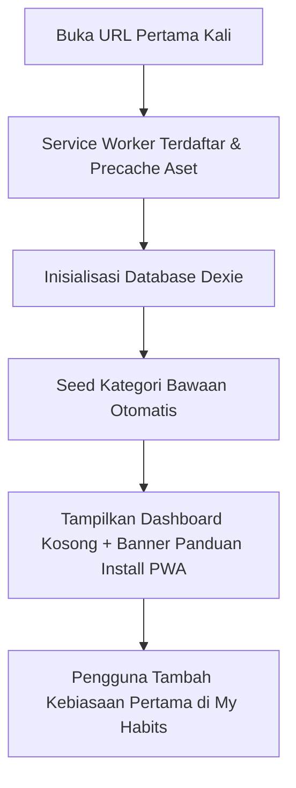
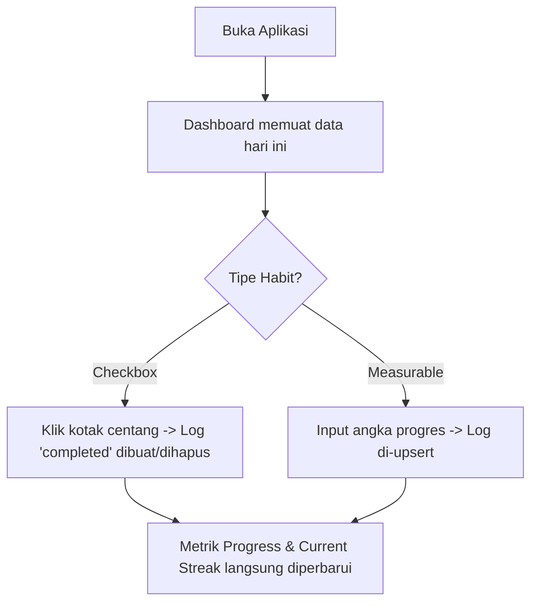
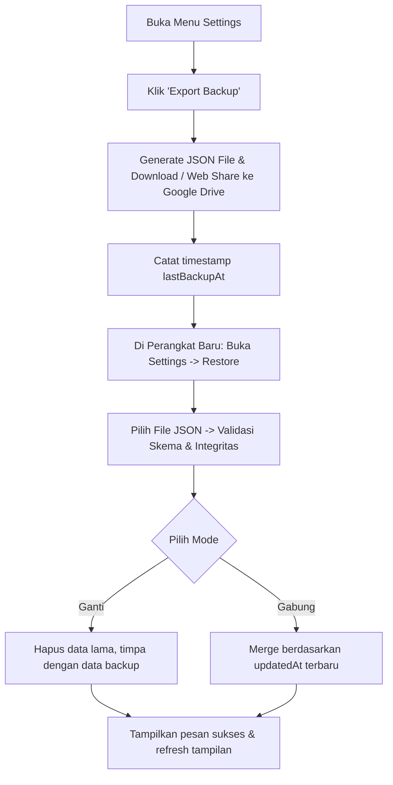

# Product Requirement Document (PRD)
# Project: HABITLY

**Versi:** 1.0  
**Status:** Approved / Ready for Implementation  
**Tanggal:** 12 November 2026  
**Penulis / Pemilik:** Jerry Sutisno  
**Tipe Aplikasi:** Local-First Progressive Web Application (PWA)  

---

## 1. Executive Summary & Visi Produk

### 1.1 Visi Produk
**HABITLY** (*"Build Better Habits, Build a Better You"*) adalah aplikasi habit tracker pribadi yang berfokus pada kesederhanaan, privasi mutlak, kemandirian perangkat (local-first), dan kehandalan tanpa ketergantungan pada server internet atau biaya operasional (biaya Rp0 seumur hidup).

### 1.2 Latar Belakang & Masalah
Banyak aplikasi habit tracker modern mengalami masalah:
1. **Ketergantungan Akun & Server:** Mengharuskan pendaftaran email, sinkronisasi cloud yang lambat, dan risiko kebocoran data pribadi.
2. **Model Berlangganan / Paywall:** Fitur analitik, pengingat, dan riwayat sering dikunci di balik sistem langganan bulanan/tahunan.
3. **Kerapuhan Koneksi:** Sering gagal mencatat atau lambat ketika koneksi internet lemah atau offline.
4. **Kehilangan Kepemilikan Data:** Pengguna tidak memiliki kendali penuh atas data mereka dan tidak dapat mengekspor atau memindahkannya secara transparan.

### 1.3 Solusi HABITLY
HABITLY menyelesaikan masalah tersebut dengan arsitektur **Local-First PWA**:
- **Zero Login / Zero Server:** Tidak ada akun, register, server backend, atau database cloud.
- **Penyimpanan Lokal:** Data sepenuhnya tersimpan di IndexedDB browser perangkat menggunakan Dexie.js.
- **Biaya Operasional Rp0:** Dibangun dengan open-source tech stack (React, Vite, Tailwind CSS, Dexie) dan dihosting di GitHub Pages.
- **Full Offline Capability:** Service Worker melakukan precache terhadap seluruh aset aplikasi (termasuk font dan icon lokal), sehingga dapat digunakan 100% tanpa internet.
- **Kedaulatan Data:** Mekanisme Export/Import file JSON terstruktur dengan validasi ketat, mendukung mode Ganti (Replace) atau Gabung (Merge).

---

## 2. Target Pengguna & Personas

### 2.1 Target Pengguna
- **Individual Tracker:** Pengguna tunggal (single-user personal app) yang mengutamakan kecepatan pencatatan, konsistensi harian, dan privasi penuh.
- **Platform Penggunaan:** Smartphone Android (via browser Chrome/Edge yang diinstal ke Home Screen) dan Laptop/PC (Desktop Browser Chrome/Edge/Firefox).

### 2.2 User Persona
- **Nama:** Alex (26 tahun, Profesional / Pelajar Mandiri)
- **Kebutuhan:**
  - Ingin mencatat rutinitas harian (olahraga, membaca buku, minum air, tidur teratur) dalam hitungan detik.
  - Ingin melihat tren dan konsistensi (streak, analytics mingguan/bulanan) tanpa terganggu iklan atau paywall.
  - Membutuhkan aplikasi yang instan terbuka tanpa login dan tetap berfungsi normal meski sedang di pesawat atau area minim sinyal.
- **Kekhawatiran:** Takut data hilang saat ganti perangkat atau browser membersihkan cache; diselesaikan dengan banner pengingat backup dan ekspor JSON ke Google Drive.

---

## 3. Prinsip Desain & Rekayasa Produk

1. **`habit_logs` sebagai Single Source of Truth:**
   Tidak ada redundansi data statistik (streak, daily completion rate, weekly rate tidak disimpan sebagai kolom statis). Semua metrik dihitung secara dinamis (*computed purely*) dari tabel riwayat log.
2. **Kemandirian Total (Zero External Calls):**
   Aplikasi tidak melakukan request HTTP ke API atau CDN mana pun saat beroperasi. Semua aset, stylesheet, font (@fontsource), dan ikon (Lucide) dibundel lokal.
3. **Mobile-First & Efisiensi Sentuhan:**
   Pencatatan harian dapat diselesaikan dalam 1–2 ketukan. Target sentuh minimal 44x44 px dengan bottom navigation untuk smartphone dan sidebar untuk desktop.
4. **Integritas Transaksional Lokal:**
   Setiap operasi relasional (seperti hapus habit beserta lognya, atau restore data) wajib atomic via IndexedDB transaction.

---

## 4. Alur Pengguna (User Journeys)

### 4.1 Onboarding & Penggunaan Pertama (First Launch)

1. Pengguna membuka URL aplikasi.
2. Database IndexedDB `habitly-db` dibuat otomatis beserta 5 kategori bawaan: *Health, Education, Productivity, Personal Development, Finance*.
3. Aplikasi langsung menampilkan Dashboard tanpa form login atau splash screen yang lambat.
4. Muncul opsi untuk menginstal PWA ke layar utama perangkat.

### 4.2 Alur Pencatatan Harian (Daily Check-in)

1. Pengguna membuka aplikasi; Dashboard mendeteksi tanggal lokal (`YYYY-MM-DD`).
2. Checklist menampilkan semua kebiasaan yang terjadwal untuk hari tersebut.
3. Pengguna menekan tombol centang (untuk tipe *checkbox*) atau memasukkan nilai progres (untuk tipe *measurable*).
4. Persentase kemajuan harian (*Today's Progress*) dan *Streak* langsung diperbarui secara reaktif.

### 4.3 Alur Backup & Pemindahan Data (Data Portability)

---

## 5. Kebutuhan Fungsional (Feature Specifications)

### 5.1 Dashboard
- **Header & Sapaan:** Menampilkan sapaan dinamis berdasarkan waktu (Pagi/Siang/Sore/Malam), nama panggilan pengguna (jika diatur di Settings), dan tanggal hari ini dalam format lokal (misal: "Kamis, 12 November 2026").
- **Today's Progress Card:** Menampilkan persentase pencapaian hari ini dengan visual progress bar / progress circle.
- **Summary Counters:**
  - *Active Habits*: Jumlah kebiasaan aktif yang terjadwal hari ini.
  - *Current Streak*: Jumlah hari berturut-turut di mana semua kebiasaan terjadwal berhasil diselesaikan penuh.
- **Daily Checklist:**
  - Daftar kebiasaan yang terjadwal untuk hari ini (berdasarkan hari dalam seminggu).
  - Tipe *Checkbox*: Satu ketukan untuk toggle status (completed / uncheck).
  - Tipe *Measurable*: Input angka cepat dengan tombol plus/minus atau input langsung, menampilkan `value / targetValue targetUnit`. Status otomatis `completed` jika `value >= targetValue`.
  - Tombol aksi opsional: Opsi untuk menandai `skipped` (dengan alasan/catatan singkat).
- **Weekly Overview:** Strip 7 hari terakhir yang menunjukkan ringkasan tingkat penyelesaian harian.
- **Recent Activity:** Log aktivitas terakhir yang mencatat pencapaian kebiasaan.
- **Backup Reminder Banner:** Banner peringatan halus jika backup belum pernah dibuat atau sudah berusia lebih dari 7 hari.

### 5.2 Manajemen Kebiasaan (My Habits)
- **Tampilan Daftar:** Menampilkan seluruh kebiasaan aktif, dikelompokkan berdasarkan kategori atau difilter berdasarkan status.
- **Informasi Kartu Habit:**
  - Nama & deskripsi kebiasaan.
  - Badge kategori & warna khusus.
  - Tipe kebiasaan (*checkbox* / *measurable* beserta target).
  - Frekuensi (Setiap Hari vs Hari Tertentu: misal Sen, Rab, Jum).
  - Indikator Current Streak & Best Streak untuk kebiasaan tersebut.
- **Aksi CRUD:**
  - *Tambah Habit Baru*: Modal/form validasi lengkap.
  - *Edit Habit*: Mengubah konfigurasi habit (perubahan jadwal berlaku ke depan).
  - *Arsipkan Habit*: Menonaktifkan habit dari checklist harian tanpa menghapus riwayat log di masa lalu.
  - *Hapus Habit*: Menghapus permanen habit beserta seluruh log riwayatnya secara kaskade (dengan dialog konfirmasi bahaya).
- **Kategori Kustom:** Pengguna dapat menambah kategori baru atau memilih kategori bawaan.

### 5.3 Kalender Riwayat (Calendar)
- **Navigasi Bulanan:** Menampilkan grid kalender bulanan dengan tombol panah bulan sebelumnya/berikutnya dan tombol "Hari Ini".
- **Visualisasi Status Hari:**
  - *Semua Selesai*: Seluruh kebiasaan terjadwal pada tanggal tersebut selesai (Ikon centang + warna aksen).
  - *Sebagian Selesai*: Sebagian kebiasaan selesai (Ikon setengah / parsial).
  - *Tidak Ada yang Selesai*: Ada jadwal tetapi tidak ada yang selesai (Ikon silang / peringatan).
  - *Tidak Ada Jadwal*: Tanggal tanpa kebiasaan terjadwal (Netral).
  - *Mendatang*: Tanggal setelah hari ini (Disabled / netral).
  - **Aksesibilitas:** Status tidak hanya dibedakan dengan warna, melainkan wajib menggunakan ikon dan label/tooltip yang jelas.
- **Detail Tanggal & Retroactive Logging:**
  - Klik pada tanggal masa lalu (hingga maksimal 7 hari ke belakang) menampilkan modal detail log untuk tanggal tersebut.
  - Pengguna dapat mengisi atau merevisi log untuk tanggal tersebut (dalam batas 7 hari). Tanggal lebih dari 7 hari lalu terkunci sebagai *read-only*.

### 5.4 Analitik & Laporan (Analytics)
- **Filter Rentang Waktu:** 7 Hari Terakhir, 30 Hari Terakhir (Default), 90 Hari Terakhir.
- **Metrik Utama:**
  - *Completion Rate (%):* `(Total Log Completed / Total Jadwal Lewat Tanpa Skipped) * 100%`.
  - *Total Habits Completed:* Total akumulasi log berhasil pada rentang waktu terpilih.
  - *Best Habit:* Kebiasaan dengan completion rate tertinggi (syarat: minimal memiliki 7 hari terjadwal dalam rentang tersebut).
  - *Most Consistent Day:* Hari dalam seminggu (Senin s/d Minggu) dengan performa penyelesaian tertinggi.
- **Visualisasi Grafik (Recharts):**
  - *Weekly Performance*: Tren performa mingguan.
  - *Monthly Performance*: Tren performa per bulan.
  - *Category Breakdown*: Proporsi penyelesaian berdasarkan kategori habit.

### 5.5 Pengaturan & Utilitas (Settings)
- **Preferensi Pengguna:**
  - Nama Panggilan (opsional, untuk personalisasi sapaan).
  - Pemilihan Tema: *Light*, *Dark*, atau *System Default*.
- **PWA & Storage Management:**
  - Tombol pasang aplikasi (*Install App*) jika browser mendukung event install prompt.
  - Status penyimpanan persisten (`navigator.storage.persist()`) beserta indikator ukuran estimasi IndexedDB.
  - Panduan instalasi manual untuk Android dan Desktop.
- **Backup & Restore Data:**
  - *Export JSON*: Mengunduh file backup JSON lengkap bertanggal (`habitly-backup-YYYY-MM-DD.json`), dengan integrasi Web Share API di Android.
  - *Restore JSON*: Mengunggah file backup, menampilkan ringkasan data, dan memilih opsi **Ganti Semua Data (Replace)** atau **Gabung (Merge)**.
- **Danger Zone:**
  - Reset / Hapus Seluruh Data dengan pengaman konfirmasi mengetikkan teks validasi `"HAPUS"`.

---

## 6. Aturan Logika Bisnis (Business Rules)

| No | Komponen | Aturan Logika |
|---|---|---|
| 1 | **Definisi Selesai (Completed)** | - Checkbox: Selesai jika nilai status `completed`. - Measurable: Selesai jika `value >= targetValue`. Nilai di bawah target tetap dicatat sebagai progres. |
| 2 | **Status Log** | Hanya menyimpan `completed` dan `skipped`. Hari terjadwal yang lewat tanpa log dianggap *missed* saat perhitungan dinamis (tidak ada row missed di DB). |
| 3 | **Pengaruh Skipped** | Hari berstatus `skipped` bersifat netral: dikeluarkan dari penyebut progress harian dan **tidak memutus streak**. |
| 4 | **Batal Centang** | Menghapus baris log pada database (menghindari tumpukan data kosong). |
| 5 | **Perhitungan Progress Harian** | $\text{Progress} = \frac{\text{Kebiasaan Terjadwal Completed}}{\text{Kebiasaan Terjadwal Total} - \text{Skipped}} \times 100\%$. Jika penyebut = 0, tampilkan empty state (hindari *division by zero*). |
| 6 | **Perhitungan Streak** | - **Streak Habit:** Hari terjadwal berturut-turut yang completed. - **Dashboard Streak:** Hari berturut-turut di mana semua jadwal harian selesai 100%. - Hari ini yang belum selesai tidak memutus streak (streak dihitung hingga kemarin + 1 jika hari ini selesai). |
| 7 | **Batas Retroaktif** | Log hanya boleh diisi/diedit untuk hari ini dan maksimal mundur 7 hari ke belakang ($D - 7$). Tanggal mendatang diblokir. |
| 8 | **Zona Waktu & Tanggal** | Disimpan dalam string lokal `YYYY-MM-DD` via fungsi utilitas `getTodayString()`. Dilarang menggunakan `toISOString().slice(0, 10)` karena mengembalikan tanggal UTC. |

---

## 7. Kebutuhan Non-Fungsional (NFR)

1. **Biaya & Infrastruktur:**
   - Biaya operasional wajib Rp0.
   - Tanpa database cloud atau subscription service apa pun.
   - Hosting melalui GitHub Pages pada repository publik.
2. **Kinerja & Responsivitas:**
   - Waktu buka awal (First Contentful Paint) < 1.2 detik pada jaringan standar.
   - Waktu muat saat offline < 300 ms (instan melalui service worker cache).
   - Seluruh kalkulasi analitik dan streak wajib diselesaikan < 50 ms untuk volume 10.000 log riwayat.
3. **Kompatibilitas & Portabilitas:**
   - Bekerja optimal di Android Chrome/Edge dan Desktop Browser modern.
   - PWA Standalone Mode dengan dukungan notch/safe area (`env(safe-area-inset-*)`).
4. **Privasi & Keamanan Data:**
   - Data 100% tersimpan di perangkat lokal pengguna.
   - Tidak ada analytics tracking, telemetry, atau third-party scripts.

---

## 8. Release Roadmap

- **Fase 1: UI/UX & Design System** – Wireframe, responsive layout, tema Dark/Light.
- **Fase 2: Setup Proyek & Dummy Frontend** – Vite, React, Tailwind, HashRouter, komponen dasar.
- **Fase 3: Core Calculation Engine** – Fungsi murni tanggal, progress, streak, analytics + Vitest unit test.
- **Fase 4: IndexedDB Data Layer** – Dexie schema, repository service, transaksi atomic, fake-indexeddb test.
- **Fase 5: Integrasi Fitur Inti** – CRUD habits, checklist harian, kalender interaktif, grafik analitik.
- **Fase 6: Backup & Restore Engine** – JSON export/import validator, merge algorithm, UI reminder.
- **Fase 7: PWA, Service Worker & Offline Hardening** – Precache, manifest, install prompt, persistent storage.
- **Fase 8: CI/CD GitHub Actions & Production Deploy** – Deployment ke GitHub Pages, cross-device testing, dokumentasi.
